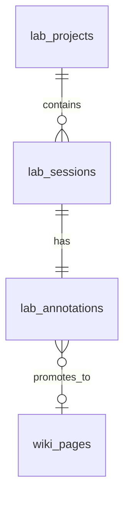

# CYBER//LAB Cloud SQL 数据库持久化与私人 Wiki 打通设计规范

- 日期：2026-11-23
- 状态：已确认 (Approved)
- 目标：将 CYBER//LAB 赛博实验室的实验与对话数据迁移并持久化至 Google Cloud SQL (`postgres` 数据库)，并与同库的私人 Wiki (`wiki_pages` 表) 实现双向打通与成果沉淀。

---

## 1. 架构目标与背景

### 1.1 现状与痛点
- 目前 CYBER//LAB 纯静态工作台的聊天记录、项目、实验笔记和遥测数据仅保存在浏览器 `localStorage`（键 `cyberchat.v1` 与 `cyberlab.annotations.v1`）。
- 服务端 Cloud Run 虽然配置了 Cloud SQL 连接器（连接 `karas-513205:us-central1:super-roach-db`），但目前仅在 `/api/health` 中执行了数据库连接健康探测，未承载任何业务数据。
- 用户的个人知识库（私人 Wiki，`karas-knowledge`）全量数据已以 `wiki_pages` 表的形式存放在同一 Cloud SQL 实例的 `postgres` 数据库中。

### 1.2 预期收益
- **云端持久化与多端同步**：实验数据落地 Cloud SQL，支持跨设备同步与持久可靠备份，彻底摆脱单一浏览器存储受限及偶发清理的风险。
- **实验与知识库一体化**：实验探索中得出的关键结论、洞察与可复现对话，可一键提炼沉淀为结构化的 Wiki 知识页面，进入私人知识库图谱。

---

## 2. 数据库设计 (Cloud SQL `postgres`)

在 `super-roach-db` 实例的 `postgres` 数据库中创建赛博实验室专属业务表，与已有的 `wiki_pages` 表共存于同一数据库：

### 2.1 实体关系图


### 2.2 表结构定义 (DDL)

```sql
-- 1. 项目表：存储实验项目及其专属协议配置
CREATE TABLE IF NOT EXISTS lab_projects (
    id VARCHAR(64) PRIMARY KEY,
    name VARCHAR(128) NOT NULL,
    system_prompt JSONB DEFAULT '{"enabled": false, "text": "", "presetId": null}'::JSONB,
    active_session_id VARCHAR(64),
    created_at BIGINT NOT NULL,
    updated_at BIGINT NOT NULL
);

-- 2. 实验会话与对话消息表：存储多轮问答流与遥测快照
CREATE TABLE IF NOT EXISTS lab_sessions (
    id VARCHAR(64) PRIMARY KEY,
    project_id VARCHAR(64) NOT NULL REFERENCES lab_projects(id) ON DELETE CASCADE,
    title VARCHAR(128) NOT NULL,
    messages JSONB DEFAULT '[]'::JSONB,
    created_at BIGINT NOT NULL,
    updated_at BIGINT NOT NULL
);
CREATE INDEX IF NOT EXISTS idx_lab_sessions_project ON lab_sessions(project_id);

-- 3. 实验沉淀与标签笔记表（含 Wiki 关联）
CREATE TABLE IF NOT EXISTS lab_annotations (
    session_id VARCHAR(64) PRIMARY KEY REFERENCES lab_sessions(id) ON DELETE CASCADE,
    tags JSONB DEFAULT '[]'::JSONB,
    notes TEXT DEFAULT '',
    runs JSONB DEFAULT '{}'::JSONB,
    wiki_path VARCHAR(256),             -- 关联已沉淀的 wiki_pages.path
    wiki_synced_at TIMESTAMP WITH TIME ZONE,
    updated_at BIGINT NOT NULL
);
CREATE INDEX IF NOT EXISTS idx_lab_annotations_wiki ON lab_annotations(wiki_path);
```

---

## 3. 后端服务与 API 契约 (`cloudrun/server.mjs`)

### 3.1 环境变量调整
- `DB_NAME`: 从 `cyber_lab` 调整为 `postgres`。
- 服务端保留原有 Cloud SQL Node Connector 与 IAM 认证机制，以 `cyber-lab-runtime@karas-513205.iam` 身份执行操作。

### 3.2 接口定义

#### 1) `GET /api/lab/workspace`
- **用途**：页面初次加载或手动刷新时拉取全量工作区数据。
- **响应格式**：
  ```json
  {
    "status": "ok",
    "workspace": {
      "activeProjectId": "p-123",
      "projects": [
        {
          "id": "p-123",
          "name": "项目名称",
          "systemPrompt": { "enabled": true, "text": "...", "presetId": "coder" },
          "activeSessionId": "s-456",
          "createdAt": 1732338000000,
          "updatedAt": 1732338000000,
          "sessions": [
            {
              "id": "s-456",
              "title": "实验会话标题",
              "createdAt": 1732338000000,
              "updatedAt": 1732338000000,
              "messages": [...]
            }
          ]
        }
      ]
    },
    "annotations": {
      "version": 1,
      "sessions": {
        "s-456": {
          "tags": ["AI/ML", "实践"],
          "notes": "本次实验的核心收获...",
          "runs": { ... },
          "wikiPath": "entities/experiment-s-456.md",
          "wikiSyncedAt": "2026-11-23T12:00:00Z",
          "updatedAt": 1732338000000
        }
      }
    }
  }
  ```

#### 2) `POST /api/lab/sync`
- **用途**：前台防抖或离线恢复后向云端增量同步工作区数据。
- **请求体**：包含 `workspace` 和 `annotations` 对象。
- **处理策略**：采用 `UPSERT`（`ON CONFLICT (id) DO UPDATE`）保证幂等性与事务原子性。

#### 3) `POST /api/lab/promote-to-wiki`
- **用途**：将指定实验会话转化为结构化的知识库文章并插入 `wiki_pages` 表。
- **请求体**：
  ```json
  {
    "sessionId": "s-456",
    "category": "学习笔记",
    "title": "大模型测试时计算与推理预算实验",
    "tags": ["AI/ML", "实践", "实验记录"]
  }
  ```
- **生成 Markdown 规范**（对齐 `karas-knowledge` Schema）：
  ```markdown
  ---
  title: 大模型测试时计算与推理预算实验
  created: 2026-11-23
  updated: 2026-11-23
  type: note
  tags: [AI/ML, 实践, 实验记录]
  sources: [cyber-lab/session-s-456]
  confidence: high
  contested: false
  contradictions: []
  ---

  # 大模型测试时计算与推理预算实验

  ## 核心结论与洞察
  [提炼自实验笔记 notes]

  ## 实验过程与关键对话
  [格式化的关键 User 提问与 Assistant 回复]

  ## 运行遥测
  - 模型：gpt-4o
  - 首 Token 延迟：350ms
  - 总耗时：1420ms
  ```
- **响应**：`{ "status": "ok", "wikiPath": "entities/experiment-s-456.md" }`。

---

## 4. 前端交互与 Local-first 混合架构

1. **零阻断用户体验**：
   - 聊天输入与界面切换依然优先读写本地 `localStorage`，打字无任何网络延迟。
   - 页面加载时异步请求 `/api/lab/workspace`：若本地为空则拉取云端数据填充；若云端数据较新则提示合并。
   - 状态变更后自动防抖 2 秒向 `/api/lab/sync` 提交更新。
2. **观测台界面增强**：
   - 在侧边观测台的“标签与实验结论”模块下方增加按钮：**【沉淀至私人 Wiki】**。
   - 点击弹出模态框，允许微调 Wiki 标题、分类（如下拉选择“学习笔记”、“大模型二三事”、“开源项目”等已有的 Wiki 分类）。
   - 提交成功后，该实验卡片展示“已同步至 Wiki: `[[path]]`”高亮徽标。

---

## 5. 权限、安全与上线验证

1. **权限控制**：
   - `cyber-lab-runtime@karas-513205.iam` 需被授予 `lab_*` 表及 `wiki_pages` 的 `SELECT`, `INSERT`, `UPDATE` 权限。
2. **发布与验证流程**：
   - 执行 DDL 脚本完成 Cloud SQL 表结构初始化。
   - 本地运行 `npm run check` 确保类型检查与已有单元测试无回归。
   - 编写针对 `/api/lab/sync` 与 `/api/lab/promote-to-wiki` 的单元测试。
   - 提交 Git Commit 并推送到 GitHub，触发 EdgeOne 与 Cloud Run 的自动构建部署。
